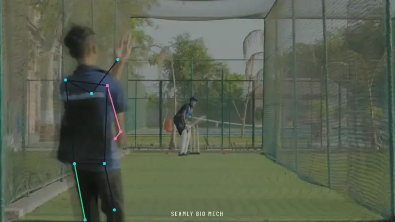
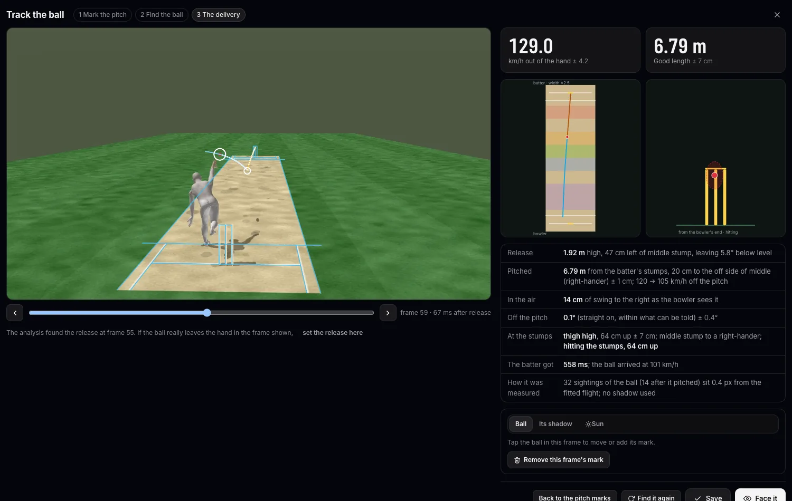
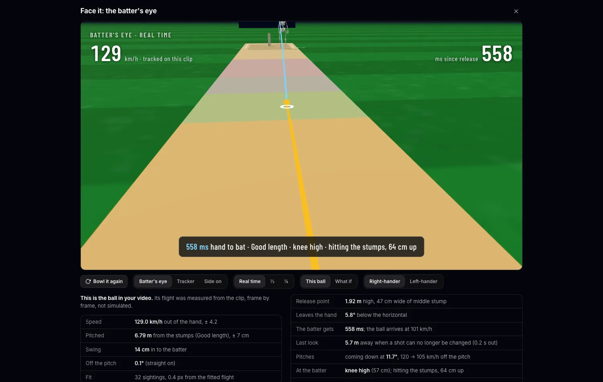
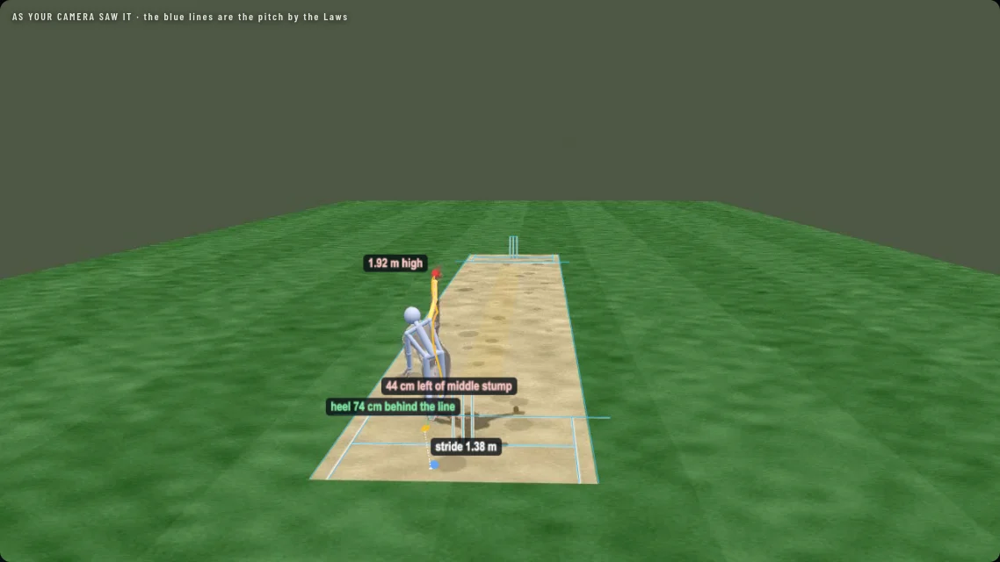
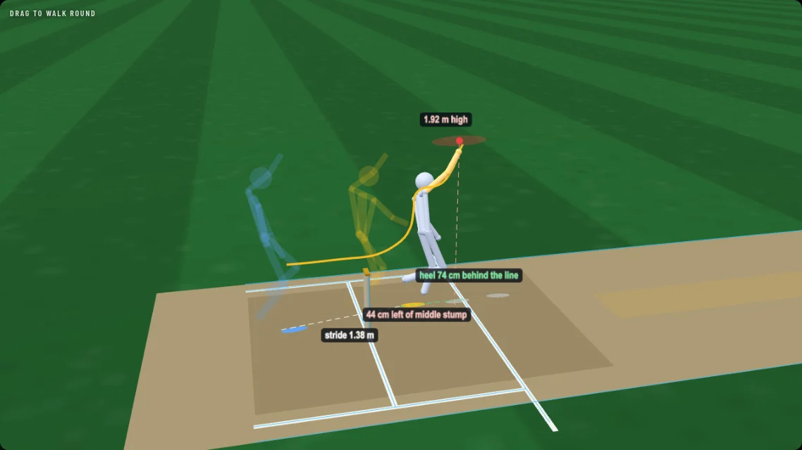
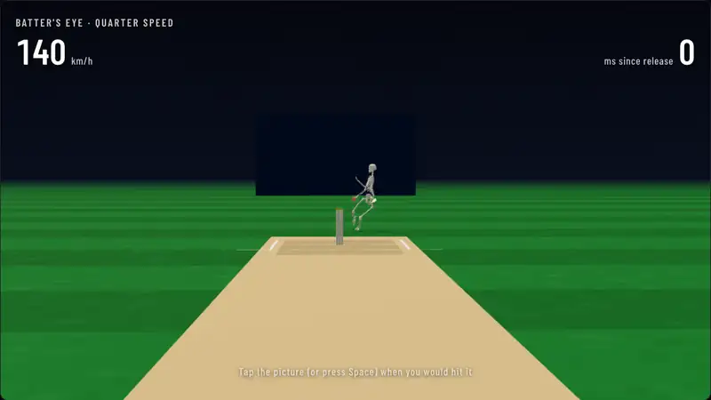
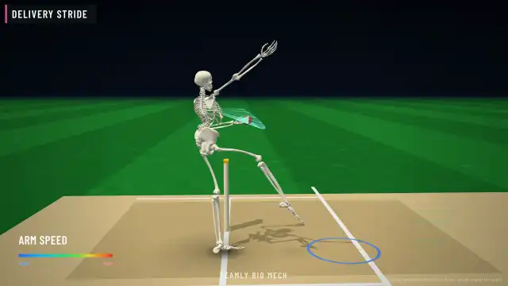

# Seamly: your pocket bowling coach

**Broadcast-style bowling analysis from one phone video. Free, in the browser, nothing uploaded.**

**[Try it now: seamly-cricket.vercel.app](https://seamly-cricket.vercel.app)** · open the **tracked test ball** example from the home page and press **Ball tracked**, **3D replay** or **Face it**

<p align="center">
  <a href="https://seamly-cricket.vercel.app"></a>
</p>
<p align="center"><sub>A real recording of the app, not a mock-up: one 60 fps phone clip from behind the bowler (bundled example "nets from behind", scored 88/100), replayed by Seamly's Save as video. The arm slot on the glass plane (22°) and the side-bend are measured on the video; the skeleton's run-in from this angle is assumed, and the replay says so on screen.</sub></p>

### New: ball tracking from one ordinary camera. The real flight, measured, with error bars.

<p align="center">
  <a href="https://seamly-cricket.vercel.app"></a>
</p>

Film from behind the bowler's arm (or behind the batter) with both ends of the pitch in shot. Seamly looks for the pitch itself; when it cannot be sure, tap the middle stump at each end and it finds the creases around your two taps. The rest happens in your browser:

- **The camera comes from the pitch.** The creases are a ruler the Laws fix to the millimetre. Seamly finds the painted lines, checks that their spacing is a pitch's spacing seen in perspective, and solves the camera's position, direction and zoom from them. The pitch is drawn back over the picture so you can see the fit; faint or worn creases can still be marked corner by corner.
- **The ball is found frame by frame**, with the camera's own zoom and pan cancelled first, so it works on broadcast footage as well as a phone on a tripod. Every sighting can be checked, moved or removed.
- **One flight is fitted through every sighting**: gravity and drag in the air, a bounce on the known ground, and the path off the pitch. In sunshine the ball's shadow is used as a second line of sight.
- **You get** release speed, where it pitched (length and line), swing in the air, movement off the pitch, height at the stumps and hitting or missing, each **with its own ±**, plus a pitch map. **Face it** then replays that very ball from the batter's eye.

How good is it? On rendered deliveries with exact truth: speed within 2 to 3 km/h, length within 15 cm, line within 2 cm, height at the stumps within 5 cm. On four international deliveries from broadcast footage at 25 frames a second, with the pitch found by the app and checked against the speed gun on screen: 6.1% off on average (worst 7.3%), each within one and a half of the tracker's own stated error; a fifth was refused rather than guessed. Length and line have no ground truth on real footage yet. All of it, including where it fails, is in [docs/ACCURACY.md](docs/ACCURACY.md) §9f and §9g.

<p align="center">
  
</p>
<p align="center"><sub>Both pictures are the app itself on a rendered test delivery whose true figures are known (131 km/h, pitched 6.80 m from the stumps): the bundled example "tracked test ball". Broadcast footage was used for testing only and is not in this repository.</sub></p>

### On the pitch. Measured in metres, with the stumps as the ruler.

<p align="center">
  
  
</p>

Film from behind the bowler with the crease lines in the picture, and that is all: Seamly finds the creases itself, works the camera out from them, and the delivery is rebuilt in real metres: feet, stride, release point and the bowler's own height, each with its ±, and the ball's measured flight when it can be followed. Nothing to mark. Truth here was 1.90 m and 45 cm.

### Face it. Stand in against the bowler you just filmed.

<p align="center">
  <a href="https://seamly-cricket.vercel.app"></a>
</p>
<p align="center"><sub>A real recording of the app (bundled example "nets from behind", set to 140 km/h with away swing; captured at quarter speed and played here at full speed, then slowed). The bowler and the release point come from the clip; the ball's flight is physics.</sub></p>

One button puts you at the batter's crease. The bowler is the skeleton rebuilt from your clip, running in and letting go in real time. The ball leaves from **where that bowler's hand actually was** and flies by physics: gravity, air drag, swing, and a bounce off the pitch. Tap when you would hit it and Seamly tells you how many milliseconds early or late you were.

Then it answers the questions a bowling coach and a batting analyst both ask of a release point:

- **How long does the batter get?** Hand to bat in milliseconds, the speed the ball arrives at, and how far away it still is at the last moment a shot can be changed.
- **What does each length cost?** The release angle a yorker, a good length and a bouncer each need from this hand at this pace, and how narrow the window is: on a good length, about one degree of release angle is a metre of length.
- **What is height worth?** How much higher the same ball reaches the batter if the bowler lets go 10 cm higher: the reason the app coaches a braced front knee and a tall release, as a number.
- **Where does it finish?** Ankle, knee or chest high at the batter, and hitting or missing the stumps by how much, from the batter's eye, a ball-tracker view and side-on.

The pace is the one measured on your clip when you have measured it; the line, length and swing are yours to set. The flight agrees with an independently written fine-step integration to within 4 mm ([docs/ACCURACY.md §9e](docs/ACCURACY.md)).

Film one delivery. A minute or two later you have what a broadcast analyst's desk produces, on your own bowler:

| | |
|---|---|
| **The key moments, found for you** | Back-foot contact, front-foot contact, release and follow-through, marked on your own video with the skeleton and joint angles. A frame out? Drag it; everything recomputes in a third of a second. |
| **A 3D replay worth showing a dressing room** | An anatomical skeleton on a pitch, stopping at each key moment with the numbers measured there, the arm's speed as a ribbon, the kinetic chain from hips to hand, the **swing plane** with the arm slot, an action strobe, a ghost of another delivery to compare, and a video file to share. |
| **Numbers you can stand behind** | Knees, trunk, stride, release height, side-bend, alignment, arm slot: each against published norms, each with its confidence. What the camera angle can't see is withheld, not guessed, and the app says which angle would measure it. |
| **Coaching, not just charts** | A score, the one thing to fix first with its cue, a back-health screen for pace bowlers, and a two-week plan inside Cricket Australia's junior workload limits. |
| **Ball tracking** | The ball's real flight from one camera behind the arm: speed, length, line, swing, movement off the pitch and height at the stumps, each with its uncertainty. The pitch is found from its creases (on its own, or around two taps on the stumps); the ball is found for you. |
| **On the pitch 3D** | Filmed from behind: the delivery rebuilt in real metres on the pitch, with nothing to mark. Seamly finds the crease lines at the bowler's end (or the whole pattern on broadcast footage), solves the camera from them, and reports where each foot landed, the stride, the front heel against the popping crease, where the ball left the hand (height, and distance from middle stump) and the bowler's own height, each with its ±. The ball's flight is tracked and drawn in the same scene when the far end can be seen. It opens as your camera saw it, with the pitch drawn over the video, then you walk round it. |
| **Face it** | Stand at the batter's end and face the delivery in 3D, in real time: the ball flies by physics from this bowler's own release point, and the app says what that release is worth in reaction time, release angle and bounce. |
| **Pace, no radar** | Ball speed from the same clip, timed over the pitch's fixed length, with an honest range. |
| **Private by construction** | The models run on the device. There is no account, no upload and no server; it works offline at the nets. |

<p align="center">
  
</p>
<p align="center"><sub>Side-on (bundled example "club match"): the skeleton's knees follow the angles measured on the video, the arrow on the hand is its velocity, and the plane's lean is left unnumbered because a side-on camera can't see it.</sub></p>

**What it has been tested on.** Every claim here has a test behind it and a page that says where it breaks: [docs/ACCURACY.md](docs/ACCURACY.md) covers scripted deliveries with known ground truth, real club and net clips, IPL net sessions and ten deliveries from international broadcasts, including the clips it got wrong and why. 463 front-end tests and 53 engine tests run against a Python reference implementation.

> Estimates come from a single video. Seamly is not a medical assessment and **not an ICC legality test**.
> Every metric shows its confidence. Metrics that the camera angle can't measure are not reported; the app says which angle would measure them.

## What you get

- **The key moments on your own video**, with the skeleton, joint angles and wrist trail drawn on the frame. If a marker is a frame off, drag it, and everything recomputes in about a third of a second.
- **Pace from the same clip, free.** Ball speed from the release frame and the frame the ball reaches the batter, timed over the pitch's fixed length (no calibration, slow motion divided back to real time), with an honest range that narrows if you mark where the ball pitched. Alongside it, the technique factors most linked to ball speed that the clip measures: run-up speed at back-foot contact (side-on), the time from front-foot landing to release, and the front knee at release. While measuring, a bar under the screen holds the frame controls and the marks, so the video and the result stay in view on a phone. The player page tracks speed across sessions and flags when a spell drops 5% below the day's best.
- **Camera check before you film**: point the phone where it will film from and the camera's live picture tells you whether the angle, distance, framing and light will measure well (side-on or behind the stumps), using the same pose model on the device. Nothing is recorded.
- **A 3D body model** of the delivery that you can orbit, with side, behind, batter's-view and top presets, live joint-angle tags that follow the body as it plays, and an enlarged view with its own playback.
- **Measured angles against published norms**, each with a confidence and a reference:
  - front knee at landing and release
  - trunk flexion
  - stride length
  - release height
  - side-bend
  - hip–shoulder alignment and mixed-action screening
  - head position
  - rhythm timings
- **A verdict at the top.** The score, one line on the delivery, the one thing to fix first with its coaching cue, and the facts that change how to read it (what's working, back health, camera limits). The Coaching tab has every priority with drills and a "Show me" button that jumps to the moment in the video.
- **Back-health check** for pace bowlers: side-bend at release, mixed action and a folding back leg. These are the technique factors linked to lower-back stress injuries in young fast bowlers.
- **Two-week practice plan** that respects the [Cricket Australia junior pace bowling guidelines](https://play.cricket.com.au/community/resources/player-safety/junior-bowling-guidelines/guidelines) for the player's age group: overs per spell, bowling days per week and rest days. It is dated from the coming Monday, and the re-test day can be added to the phone's calendar.
- **Player profiles and progress over time**: score and measurement trends, personal bests, "since last time", the current focus, and one tap to overlay the latest delivery on the best one filmed from the same angle.
- **A whole spell at once**: choose up to 12 clips (one ball each, say a nets spell) and they are analysed one after another for the selected player.
- **Consistency**: how much each key measurement moves from ball to ball over a player's last six deliveries from the same angle, judged against what one camera can resolve at those frame rates.
- **Bowling log**: record matches, club nets and practice per player; each week is checked against the age group's limits (bowling days, overs a day, rest days), and once three weeks are logged, this week's load is set against the 4-week average (acute:chronic ratio, with a warning above 1.3).
- **Compare two deliveries** side by side, or **overlaid**: both skeletons on one canvas, lined up at the hips, scaled to body size and matched phase by phase (each clip's own back-foot contact, front-foot contact and release line up), with a slider and play-through. Print a **coaching report**, and export **CSV / JSON / OBJ**.
- **Share summary**: one image (release frame with skeleton, score, verdict and the top fixes with cues) to send to a coach or parent through the phone's share sheet.
- **3D bio-mech replay.** One button turns a delivery into a broadcast-style sequence in full HD: the video plays through with the tracked body and the arm's speed drawn over it, dissolves into an anatomical skeleton on a cricket pitch, then stops at the top of the bound (jump clearance), back-foot contact, the back leg's deepest bend, front-foot contact and release with the numbers measured there; the bones a number is about light up. The bowling arm leaves a ribbon coloured by its speed, a **kinetic chain** panel shows the hips, trunk, arm and hand each reaching their top speed in turn, and at release the camera turns right round an **action strobe**: the body at every key moment left standing along the crease. A **swing plane** comes up as the arm comes over: a sheet of glass through the bowling shoulder that holds the pitch's line and the arm at release, with the **arm slot** read off it (measured on the video when the camera is behind or in front, where the skeleton's arm is turned to the measured lean; left unnumbered side-on, where the camera can't see it), and an arrow on the hand for its velocity. Then it dissolves back to the video. **Compare in 3D** puts another delivery in the same scene as an orange ghost, in step from its own release; camera buttons switch between the directed sequence and fixed views (side, behind, batter's eye, top). Drag to look round, scrub anywhere, save it as a video. The skeleton is tied to the measurements: side-on its knees follow the angles measured on the video, and its bowling arm reaches the measured release height, so the picture and the callouts agree. The motion is rebuilt to move like a body: fixed bone lengths, filtered directions, planted feet that stay put, a ballistic flight in the bound, and limb rotation that never flips. Everything is drawn in the browser and nothing is uploaded. Bone shapes: the OpenSim full-body model (Rajagopal et al. 2016, MIT Use Agreement).
- **On the pitch 3D.** From a clip filmed behind the bowler. When the analysis opens, the pitch is found without help: the whole crease pattern when a high or long-lens camera shows it, otherwise the bowling crease, popping crease and return creases at the bowler's end, looked for around the bowler's wicket or the bowler's own feet (on a tripod, in a picture with the bowler taken out by comparing frames). A level camera is solved from those lines; a camera from the bowler's end alone places a hand there to within a centimetre, which is why the far end is not needed. Every answer is checked against the bowler (a person's height, a release at a bowler's height, feet by the crease) before it is believed. Each frame is lined up with the marked one, so a broadcast camera's zoom and pan are followed. A heel that has stopped in the picture is placed on the ground through the camera; the hand at release is placed above the planted front foot. Reports release height and distance from middle stump, both heels, stride, feet alignment, the front heel against the popping crease (fair, no-ball, or too close to call), the back foot against the return crease, the bowler's height, run-up speed, and any step on the protected area, each with a ± that includes the doubt in the camera, and in the moment of release at low frame rates. When the front foot lands hidden behind the back leg it says so and measures nothing from it. The ball is then looked for with the same camera, starting from the measured release, and its flight joins the scene. Rendered deliveries with exact answers, hands off: pitch found on 12 of 12 cameras and frame rates in 3 to 8 s, release height 3.8 cm from the truth on average (worst 6.2), front heel 5.3 cm, stride 5.9 cm, and the ball's speed within 1.5% on average (worst 3.3%). Clips with no crease lines at the bowler's end (a bare net) are reported as not measurable. Every rule is scored against these and 39 real clips before it is kept. Details and limits in [docs/ACCURACY.md](docs/ACCURACY.md) §9i, §9k and §9l.
- **Ball tracking.** From a clip filmed behind the bowler's arm or behind the batter. The pitch is found from its painted creases: on its own when they are clear (the finder only accepts a fit with both ends, all four return creases and the Laws' spacing), otherwise around two taps on the middle stumps; or mark four or more crease corners or stumps by hand (taps snap to the painted corner). The camera is solved from them. The frames after release are searched for the ball with the camera's zoom and pan cancelled; a flight (gravity, drag 0.45, swing, one bounce, free velocity off the pitch) is fitted through the sightings, and through the ball's shadow when the sun is out. Reports release speed, release height and angle, pitching length and line, swing, deviation off the pitch, height and line at the stumps with hitting, missing or too close to call, and hand-to-bat time, each with an uncertainty from the fit and from re-fitting with the pitch marks nudged. You can correct any sighting, set the release frame, and mark an upright object's shadow to pin the sun. Saved with the analysis.
- **Face it: the batter's eye.** The delivery from the batter's crease, in real time or slowed, plus a ball-tracker view and a side-on view. The bowler is the 3D skeleton from the clip; the ball leaves the hand where the skeleton's hand is at release (its height is the one measured on the video) and flies under gravity, air drag (drag coefficient 0.45), swing as a steady side force until it pitches, and a firm-pitch bounce. Set the pace (it starts at the clip's measured pace when there is one, and at the length the marked pitching frame implies), the length, the line, the swing and a right- or left-handed batter. It reports the release angle, hand-to-bat time, arrival speed, the batter's last look (0.2 s out), the angle and speeds at the pitch, the height at the batter, hitting or missing the stumps, how much length a degree of release angle is worth, the good-length window, what 10 cm more release height buys, and the release angles every length band needs. Tap the picture when you would play the shot to see your timing in milliseconds.
- **Two cameras, one ball.** Film the same delivery side-on and from behind the stumps with any two phones (no syncing, any frame rates) and Seamly fuses them: the clips are lined up in real time at the release each one found, each foot contact one camera sees is carried to the clip that only estimated it, every measurement comes from the camera that sees its plane (knees, trunk and stride side-on; side-bend and alignment from behind; release height from both, averaged when they agree), and one score, one set of coaching and the complete three-check back-health screen cover the whole action. Both videos and the 3D body play in step, and Save clip records them together. A same-ball check compares the bowling arm and the stride's timing. When one phone filmed in slow motion and saved it at normal speed (or one clip speed was set for both), Seamly spots which clip runs at the wrong speed and by how much, from the wrist's rise to release and the stride's timing, and fixes it in one click. Tick “The same ball from two cameras” when choosing two clips, or pair them from either analysis.
- **Side-by-side clip**: a short video of the delivery in slow motion, the footage with its skeleton beside the 3D body, pausing at back-foot contact, front-foot contact and release with the numbers measured there and ending on the coaching cue. A coach can record a voice-over as it plays. It is recorded in the browser (MP4 where the browser can) and plays anywhere, WhatsApp included, without Seamly.
- **No-ball check**: on a side-on clip, mark the back edge of the popping crease on the landing frame and Seamly places the back of the front heel and says whether some of the foot landed behind the line, by how many centimetres, or that it is too close to call (±5–8 cm, from the body's proportions and the keypoint's precision). A practice check, not an umpire.
- **Squad table** for coaches and analysts: every player's latest measured numbers, best ball speed, back health, workload ratio and no-ball checks in one sortable table (sort by speed for a trial day), with a CSV for spreadsheets. A player sends their own analyses with **Send to coach** (one small file, no videos) and the coach adds it with Restore a backup.
- **Several deliveries in one video** (a nets session, a montage): Seamly lists the deliveries it found and analyses each of the others as its own analysis with one tap, sharing one stored copy of the video.
- **Works offline after the first analysis.** A service worker keeps the app and the models, so you can film and analyse at the nets with no signal.
- **Backup and restore.** One file carries every analysis and player to another browser, phone or computer. Nothing goes through a server.

## Filming tips

- **Side-on:** 10–15 m away, at hip height, square to the popping crease. This view measures the knees, trunk flexion, stride and release height.
- **From behind the stumps:** this view measures side-bend, alignment and head position. Film from behind the *bowler's* stumps, not the batter's: a batter close to the camera gets analysed instead of a far-away bowler.
- **Keep the whole action in frame**, from the last strides of the run-up to the follow-through. A tripod helps.
- **Use slow motion (120–240 fps) if your phone has it**; 30 fps works. Below 20 distinct frames per second a delivery stride lasts only 4–5 frames, so those clips are refused rather than mis-measured.

## How it works (in the browser)

```
video ─► exact frame times from the container (MP4/MOV via mp4box), frame-accurate seeking
      ─► RTMO-s on every frame: everyone in the picture, in one pass (ONNX Runtime Web: WebGPU, or WebAssembly as a fallback)
      ─► multi-person tracker: camera-motion compensation (coarse-to-fine block matching on the background, people and static
         overlays masked), constant-velocity prediction, colour appearance, pose similarity, Hungarian
         assignment, same-person duplicate boxes merged
      ─► bowler selection: the track whose arm makes a fast ~270-360° sweep with legs in view
         (a batter's two-handed swing is discounted; of two people who swing, the one who swings first is the bowler)
      ─► RTMPose-m (26 keypoints) on bowler crops with flip test-time augmentation
      ─► 2D clean-up: Hampel outliers, left/right swap repair (whole arm, then forearm; a repair that would hang the arm from the far side of the body is refused), gap filling, Butterworth
      ─► MotionBERT-Lite 3D lifting (int8 ONNX), resampled to its 50 fps training rate
      ─► metric skeleton (L-BFGS fit: constant symmetric bones, re-projection, knee hinge, physics priors)
      ─► bowling arm, camera view, world frame ─► events ─► view-aware metrics ─► coaching, insights, plan
      ─► NAVER Anny body model posed by IK, skinned in three.js
```

The analysis engine (`frontend/src/engine/`) is a TypeScript port of the Python pipeline in `backend/bowlnet/`. The test suite (`frontend/tests/`, 364 tests) checks every stage after pose detection against fixtures recorded from the Python pipeline. The results match Python exactly or to floating-point precision: events, metrics, coaching, insights, progress, the body-model binaries, and the skeleton fit to about 1 mm.

The first analysis downloads about 110 MB of models, which the browser caches afterwards. On a recent laptop a short clip takes about 15–30 s; phones take longer.

### Accuracy on a synthetic delivery with exact ground truth

| | Truth | Python pipeline | Seamly in the browser |
|---|---|---|---|
| Back-foot contact / front-foot contact / release (frame) | 36 / 48 / 55 | 35 / 47 / 55 | 35 / 47 / 55 |
| Front knee at front-foot contact | 165.0° | 168.5° | 164.0° |
| Front knee at release | 169.8° | 171.2° | 166.0° |
| Trunk flexion, front-foot contact → release | 32.0° | 30.4° | 31.7° |
| Release height | 105% | 114% | 109% |
| Stride length | 52.8% | 49.8% | 49.3% |

Full sources for every threshold are in [`docs/RESEARCH.md`](docs/RESEARCH.md).

Tested in Chrome (WebGPU), Safari's engine (WebKit, on an emulated iPhone) and Firefox (WebAssembly: a full analysis of the club clip took about 2.5 minutes headless). The club clip gets the same verdict and top fix in all three; WebKit reads the front knee a degree differently (158° against 157°) because it decodes the video slightly differently. Not yet tested on a physical phone.

## Develop

```bash
cd frontend
pnpm install
pnpm dev                 # http://localhost:5173 - the in-browser app
pnpm test                # engine parity tests (vitest)
pnpm build               # static site in frontend/dist (deploy anywhere: Vercel, Netlify, GitHub Pages)
```

`frontend/public/` holds the browser models: RTMO-s and RTMPose-m ONNX exports (OpenMMLab, Apache-2.0; see `models/LICENSES.md`), MotionBERT-Lite int8 and the Anny body asset. It also holds two sample analyses (`samples/`). The tools that regenerate them are in `backend/tools/`: `export_body_asset.py`, `make_web_samples.py`, `export_web_sample.py` and `export_fixtures.py`.

### Deploy

The site is static. The live deployment is the Vercel project `seamly`, at https://seamly-cricket.vercel.app. Build with the site URL for social previews, then deploy the output:

```bash
cd frontend && VITE_SITE_URL=https://seamly-cricket.vercel.app/ pnpm build
vercel deploy dist --prod --project seamly
```

Alternatively, connect the repository in Vercel with root directory `frontend` (framework: Vite). `frontend/public/vercel.json` sets the cache and security headers. For a sub-path such as GitHub Pages, build with `VITE_BASE=/<repo>/ pnpm build`.

**Bandwidth.** The analysis models (about 110 MB, downloaded once per browser) are fetched from jsDelivr, or failing that from GitHub's raw-file host, straight from this public repository at a pinned commit (`MODEL_COMMIT` in `frontend/src/engine/detector.ts`); the site's own copy in `public/models/` is the last resort. jsDelivr serves files up to 20 MB, so the two pose models are stored in pieces (`rtmo-s.onnx.part1..2`, `rtmpose-m-halpe26.onnx.part1..3`) and joined in the browser. A first visit therefore costs the host only the app itself (~2 MB). If a model file changes, push it, then point `MODEL_COMMIT` at that commit.

**Offline.** `vite.config.ts` generates `sw.js`, a service worker that precaches the built app; with the models in Cache Storage, Seamly works without a connection after the first analysis.

## Self-hosted server (optional, more accurate 3D)

`backend/` is the original Python engine (FastAPI). It runs YOLO11m/x-pose and can use **SAM 3D Body**, an image-based 3D model that needs about 8 GB of RAM. To use it:

```bash
python3.12 -m venv .venv && .venv/bin/pip install -r backend/requirements.txt
cd backend && ../.venv/bin/python -m tools.download_models && cd ..   # ~225 MB, checksum-verified
cd frontend && pnpm install && VITE_API=server pnpm build && cd ..
./run.sh                                                             # http://127.0.0.1:8000
```

SAM 3D Body is gated. Accept Meta's licence at https://huggingface.co/facebook/sam-3d-body-vith, log in with `.venv/bin/hf auth login`, then run `cd backend && ../.venv/bin/python -m tools.download_models --sam3d`. The server uses it automatically on machines with at least 12 GB of RAM.

Server tests: `cd backend && ../.venv/bin/python -m pytest -q` (the full suite takes about 7 minutes, including real-clip and synthetic ground-truth runs).

## How accurate is it?

Tested against synthetic deliveries with exactly known answers and against hand-marked real clips: release within
one frame on 7 of 8 real clips, front knee within about 4°, trunk lean within about 2°, side-bend from behind within
about 3°, ball speed within a few km/h with a range that holds the true speed 92–100% of the time in simulation. The
3D body is for seeing the action (about 10 cm off side-on), not for measuring it. Full numbers, method and failure
cases: [docs/ACCURACY.md](docs/ACCURACY.md).

## Known limitations

These are surfaced in the app rather than hidden:

- **Depth from one camera is ambiguous.** Knee and trunk flexion can't be measured from behind; side-bend and alignment can't be measured side-on. The app reports each metric only from the view that measures it and says which clip to add.
- **Angled cameras.** When the camera is well off the line of the pitch (high in the stands, or far to one side), the view cues contradict each other. Seamly then marks the view as angled, rates none of the body measurements (knee, trunk, stride, side-bend, alignment, release height, head position) and asks for a clip filmed square on.
- **Foot contacts from behind** are often placed from typical timing. Their timings stay unrated until you confirm the markers: drag them, or use "Set this frame as" in the Frame tab.
- **25–30 fps** limits release and timing precision to ±1 frame (33–40 ms). Elbow extension needs side-on video at 100 fps or more, and it is shown for reference only, never rated: on a rendered straight-armed delivery at 120 fps one camera read 12°.
- **Left and right can get confused.** The browser's pose model occasionally swaps a bowler's left and right limbs (1 of 17 real test clips; more often on a faceless test mannequin), which can put a measurement on the wrong leg. From in front, where the arms really do cross in the picture as the bowler turns, the repair used to make this worse; it now checks each fix against the body, which put the wrists right on one of the two front-on test clips (error against a much larger pose model down from 0.61 to 0.19 of a torso length) and not on the other, where the whole body is relabelled. When the app asks which arm bowls, check the skeleton on the video before trusting the numbers.
- **Side-bend from behind is reliable in the live (browser) engine, less so in the Python server engine.** On synthetic bends of 20°, 36° and 54° the browser read within about 3°; the server engine, with its larger pose model, read a 34° bend as 27°. Side-bend changes fast around release, so at 30 fps a release one frame off moves it several degrees: slow motion helps.
- **Ball speed is an estimate, not a radar reading.** It is timed between frames you mark, so its precision follows the frame rate and how much the ball slowed: in simulation the median error is about 3 km/h at 240 fps with the pitching frame marked and about 6 km/h at 30 fps without it. The range is always shown. The ball is too small and blurred at normal frame rates to be tracked automatically.
- **Analysis pauses while its tab is in the background.** Browsers throttle hidden tabs and can hand back stale video frames, so Seamly waits and carries on when you come back, rather than measuring the wrong frames. Keep the tab open on screen until it finishes.
- **Broadcast footage: timing yes, absolute sizes no.** On ten deliveries from 2026 internationals (docs/ACCURACY.md §9c) the release was within a frame on the eight where the bowler was found; two were not analyses of the delivery and are now marked "can't be trusted" with the replay locked. From the high camera behind the bowler, release height and side-bend come out distorted (the camera's height isn't estimated), so use them to compare one bowler ball to ball, not as absolute values.
- **The 3D replay is a picture of the analysis, with a few estimates of its own, each marked ≈.** The body is the 3D estimate from one camera. Its run through the crease is rebuilt from the foot contacts; from behind or in front the camera can't see along the pitch, so there the run-in speed (taken from the arm's speed) and the stride's length are assumed, the legs are re-solved over the pinned feet, and the picture says so. Jump clearance comes from the time in the air (gravity) and the legs' tuck, good to about a frame of timing (roughly ±25% at 30 fps); jump length also needs the run-in speed and is shown side-on only. The kinetic chain's order is only judged on slow-motion footage (90+ fps). The back leg's deepest bend is a 3D estimate. Fingers and toes are not tracked. The pitch is drawn for scale; the arm-speed ribbon is relative, not km/h.
- **The pitch finder wants clear creases and a camera with some height.** It found the pitch unaided on three of five full-HD broadcast clips and with two taps on the other two, but on soft, heavily compressed footage it declined 21 times in 22, and from a phone at head height behind the stumps the far creases are too close together for it: mark the corners by hand there.
- **Ball tracking is one camera, and says so.** Speed is its weakest figure: from 25 fps broadcast footage it was 4 to 9% off the speed gun on four deliveries, and when the ball is not seen pitching and coming on (a flighted ball hit on the half-volley) there is no speed worth quoting. It needs both ends of the pitch and their markings in shot, a camera roughly behind the arm, and a ball that stands out from the background for at least seven frames. The bowling analysis can have the release frame wrong; the tracker then takes the release from the ball and widens the speed's error. Length, line, swing and height have only been checked on rendered deliveries. It has not been compared with Hawk-Eye.
- **Face it shows a simulated flight unless the ball was tracked.** The release point's height is measured, but how wide of the stumps the bowler stands and how far down the pitch the hand is at release come from the 3D scene's assumptions, and every height scales with the bowler's height (1.80 m unless you set it). The bounce is one firm pitch; real pitches keep more or less. Seam movement, spin and reverse swing are not modelled. It is a faithful picture of what a ball from that release point at that pace does, not a record of the ball that was bowled.
- **Two cameras are tested on rendered pairs, not yet on real two-phone footage of one ball.** On synthetic pairs the second camera added 2–3 key measurements and 1–2 back-health checks, and lining the clips up by their movement kept them within 9 ms on average. Real clips of different balls paired on purpose were caught when the bowling arm differed, refused when a clip was angled, or flagged as not lining up; but the same-ball check can't tell two balls of the same bowler apart, and at 25–30 fps it only says "check". Both clips need to be square to the pitch (side-on, and behind or in front). The wrong-speed fix needs the wrist tracked in both clips, and a real-time clip analysed at a slow-motion speed usually fails outright, so if only one phone filmed in slow motion leave the clip speed at normal.
- **The no-ball check is a practice aid.** The pose model has no heel point: the heel is placed from the ankle with body proportions (on synthetic clips within 3 cm on the landing frame; shoes vary by a couple more), so anything within the stated band is called too close to call. It needs a side-on camera that sees along the crease and the right frame: one frame early, the foot hasn't landed.
- **Analyses live in the browser that made them** (IndexedDB). Nothing is uploaded, so a link only opens on that device. Clearing site data deletes them, so use **Download backup** in your workspace to keep a copy or move players and analyses to another device (Restore a backup), and the PDF report to share one.
- **The bowling arm is hard to tell from behind or front-on.** On rear-view broadcast clips the detector is often unsure, and a low-confidence call can differ between devices. Below 50% agreement Seamly asks "Is this a left-arm bowler?" with one-tap Yes/No (and marks the arm with a "?" up to 70%), and saves the answer to the player's profile so later clips don't have to guess. Setting the arm in the profile skips detection entirely.
- **Browsers decode video slightly differently** (Safari's colours are a few percent brighter than Chrome's), so the same clip can land a foot contact a frame apart in different browsers. Release, upper-arm-horizontal and follow-through matched exactly in our Safari-engine (WebKit) test.
- **The browser engine and the Python engine use different pose models** (RTMO-s and RTMPose-m in the browser; YOLO11m/x on the server, which also lacks the browser's newer release, bowling-arm and bowler-selection rules), so their answers can differ. The browser engine is the product; `docs/ACCURACY.md` §9h has the comparison.

## Project layout

```
frontend/   the Seamly web app: React + TypeScript + three.js
  src/engine/   in-browser analysis engine (detector, video, tracking, pose2d, lifter, kinematics,
                events, metrics, coaching, insights, progress, body, pipeline, store)
  src/api.ts    data layer: api.local.ts (browser, default) or api.remote.ts (VITE_API=server)
  public/       models, sample analyses, icons
  tests/        parity tests against fixtures recorded from the Python pipeline
backend/    the Python engine and FastAPI server (source of truth for the algorithms)
docs/       RESEARCH.md
legacy/     the original Streamlit + SPIN prototype
```

## Licences and credits

| Component | Licence | Note |
|---|---|---|
| Seamly code | not chosen yet | No LICENSE file yet. Everything the website ships (models, runtime, body asset) is under Apache-2.0, MIT, BSD or CC0, so the choice is open. |
| RTMO-s and RTMPose-m (OpenMMLab MMPose; the pose models in `frontend/public/models`) | Apache-2.0 | unmodified ONNX exports from download.openmmlab.com; `frontend/public/models/LICENSES.md` |
| Ultralytics YOLO11 (Python engine in `backend/` only; not in the website) | **AGPL-3.0** | weights are downloaded by you when you run the server |
| MotionBERT (model code + weights) | Apache-2.0 | `backend/bowlnet/lifting/LICENSE-MotionBERT` |
| ONNX Runtime Web | MIT | loaded from jsDelivr |
| mp4box.js | BSD-3-Clause | |
| NAVER Anny body model | Apache-2.0 code, CC0 1.0 MakeHuman/MPFB2 assets | |
| SAM 3D Body (server only, optional) | SAM License (Meta) | weights are downloaded by you |
| three.js, React, FastAPI | MIT / BSD | |
| Sample clip: "Epping Foresters CC v Great Totham CC at Epping, Essex, England Video 1" by Acabashi | CC BY-SA 4.0 | via [Wikimedia Commons](https://commons.wikimedia.org/wiki/File:Epping_Foresters_CC_v_Great_Totham_CC_at_Epping,_Essex,_England_Video_1.webm); trimmed and re-encoded (`frontend/public/samples/club-side-on.mp4`, same licence) |
| Example clip: "Hatfield Broad Oak CC v Little Hallingbury CC at Hatfield Broad Oak, Essex 127" by Acabashi | CC BY-SA 4.0 | via [Wikimedia Commons](https://commons.wikimedia.org/wiki/File:Hatfield_Broad_Oak_CC_v_Little_Hallingbury_CC_at_Hatfield_Broad_Oak,_Essex_127.webm); trimmed and re-encoded (`frontend/public/samples/club-front-on.mp4` and the frames in `samples/club-front/`, same licence) |
| Example clip: nets session, Pexels video no. 13960804 | [Pexels licence](https://www.pexels.com/license/) (free to use and modify; attribution not required, given anyway) | [pexels.com/video/13960804](https://www.pexels.com/video/13960804/); trimmed, scaled and thinned to 60 frames a second (`frontend/public/samples/nets-behind-60fps.mp4`, `samples/nets-behind/`) |
| 3D replay bones: full-body musculoskeletal model, Rajagopal et al. (2016) | MIT Use Agreement | via [SimTK](https://simtk.org/projects/full_body) / [opensim-models](https://github.com/opensim-org/opensim-models); merged into `frontend/public/skeleton/bones.bin` |
| Barlow Condensed, Barlow Semi Condensed (fonts in the 3D replay) | SIL Open Font License 1.1 | `frontend/src/assets/fonts/` |
